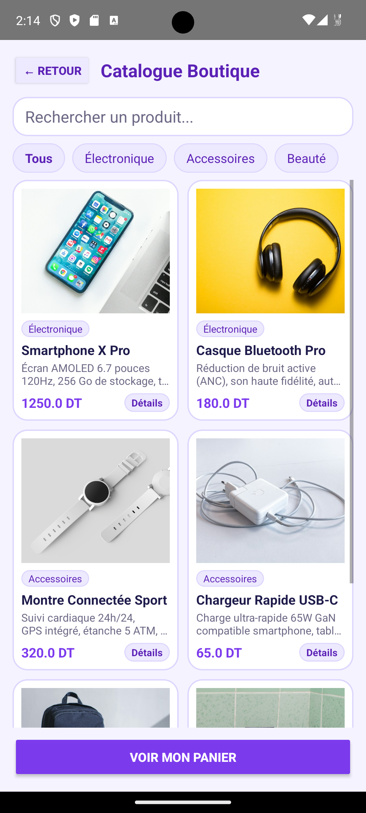
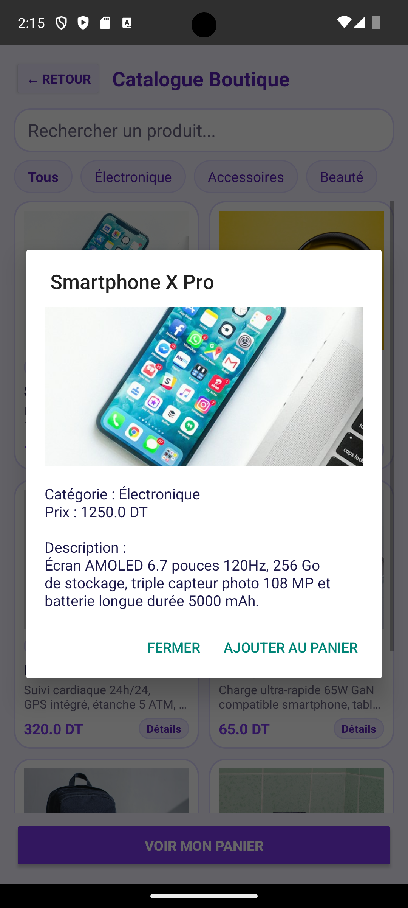
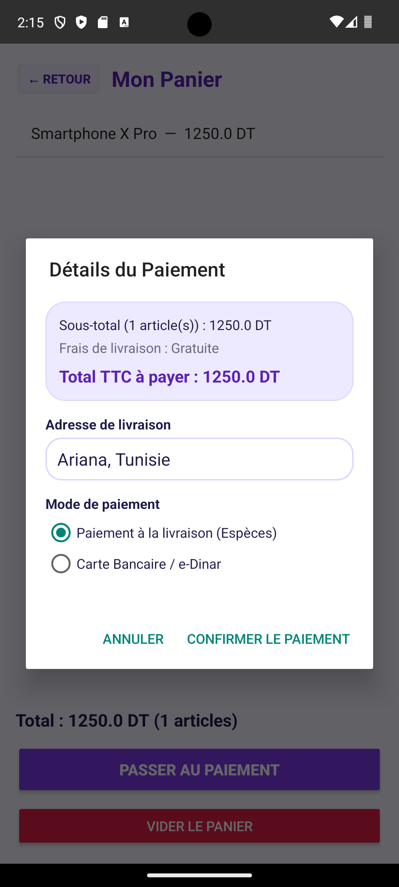

# MiniShopManager · TP Programmation Mobile

Travaux pratiques Android (Kotlin, layouts XML) · **L3-GTIC, ISET'COM** · Année 2026–2027 · Étudiante : **Asma Ben Hassine**

## Aperçu de l'application (Édition Violet Lilas)

| Catalogue (2 produits / ligne) | Détails du produit | Tunnel de paiement |
| :---: | :---: | :---: |
|  |  |  |

> **TP Final · MiniShopManager (Édition Violet Lilas)** : une boutique mobile e-commerce complète sous Android dotée d'une identité visuelle moderne en violet lilas, d'un catalogue dynamique à 2 colonnes avec photos réelles, d'un panier persistant en SQLite et d'un tunnel de paiement détaillé avec reçu de confirmation.

---

## Contenu du dépôt

| TP | Thème | Ce qui est réalisé |
| :--- | :--- | :--- |
| **TP0** | Environnement & dépôt GitHub | Initialisation du projet Android Studio, `.gitignore`, configuration Gradle |
| **TP1** | Premier projet Android | Écran d'accueil dynamique (`MainActivity`), navigation par `Intent` vers `ProfileActivity` |
| **TP2** | Catalogue & Interfaces XML | Design **Violet Lilas** (`colors.xml`, `bg_card_lilas`, `bg_badge_lilas`), grille produits à 2 colonnes |
| **TP3** | Catalogue dynamique & SQLite | Connexion (`SharedPreferences`), lecture JSON (`assets/produits.json`), base locale `DBHelper.kt` |
| **TP Final** | MiniShopManager Pro | Grandes photos réelles distantes, fiche détails produit, paiement détaillé (Espèces/Carte) et reçu avec retour |

---

## Fonctionnalités du TP Final

* **Connexion (`LoginActivity`)** : authentification utilisateur et sauvegarde de session via `SharedPreferences`.
* **Accueil (`MainActivity`)** : message de bienvenue personnalisé et résumé en temps réel du panier.
* **Catalogue à 2 colonnes (`CatalogueActivity`)** : affichage en `GridView` (2 produits par ligne) avec chargement asynchrone de grandes photos réelles depuis `assets/produits.json`.
* **Recherche & Filtres** : barre de recherche instantanée et filtres rapides par catégorie (*Tous*, *Électronique*, *Accessoires*, *Beauté*).
* **Fiche détails produit** : fenêtre modale au clic affichant la photo grand format, la catégorie, le prix, la description complète et l'ajout au panier.
* **Panier SQLite (`PanierActivity` & `DBHelper`)** : stockage local persistant, calcul automatique du sous-total et suppression des articles.
* **Paiement détaillé & Reçu (`dialog_paiement.xml`)** : saisie de l'adresse de livraison, calcul des frais, choix du mode de règlement (*Espèces à la livraison* ou *Carte Bancaire*), génération d'un reçu `#CMD-XXXXX` et redirection vers l'accueil.
* **Profil (`ProfileActivity`)** : consultation des informations du compte et déconnexion sécurisée.

---

## Structure

```text
MiniShopManager/                          <- projet principal (ouvrir ce dossier dans Android Studio)
├── app/src/main/
│   ├── AndroidManifest.xml               <- déclaration des 5 activités et permission INTERNET
│   ├── java/com/example/minishopmanager2/
│   │   ├── LoginActivity.kt              <- écran de connexion (SharedPreferences)
│   │   ├── MainActivity.kt               <- tableau de bord et résumé du panier
│   │   ├── CatalogueActivity.kt          <- grille 2 colonnes, photos réelles et détails produit
│   │   ├── PanierActivity.kt             <- gestion du panier, paiement détaillé et reçu
│   │   ├── ProfileActivity.kt            <- profil utilisateur et déconnexion
│   │   └── DBHelper.kt                   <- base de données locale SQLite (minishop.db)
│   ├── res/
│   │   ├── layout/                       <- interfaces XML (grilles, cartes, dialogue paiement)
│   │   ├── drawable/                     <- formes arrondies Violet Lilas et icônes vectorielles
│   │   └── values/                       <- palette de couleurs Violet Lilas (colors.xml)
│   └── assets/produits.json              <- catalogue des produits (prix, descriptions, URLs photos)
└── docs/                                 <- captures d'écran de l'application
```

---

## Ouvrir et lancer

1. **Android Studio** → **File → Open** → sélectionner le dossier `MiniShopManager`.
2. Attendre la fin de la synchronisation Gradle.
3. Lancer l'émulateur (ex. Pixel 7a, API 34) avec une connexion Internet active pour charger les photos produits, puis cliquer sur **Run** ▶.
4. Saisir un nom d'utilisateur sur l'écran de connexion pour accéder à la boutique.

Configuration : Kotlin · Android Gradle Plugin · `compileSdk 34` · `minSdk 24`.